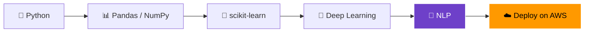

<!-- ===================== HEADER ===================== -->
<div align="center">


<a href="https://github.com/KALITH2006">
  
</a>

<br/>


<a href="https://github.com/KALITH2006?tab=followers"></a>
<a href="https://github.com/KALITH2006?tab=repositories"></a>

</div>

---

## 👨‍💻 About Me

<table>
<tr>
<td width="60%">

- 🎓 **Computer Science student** passionate about intelligent ML models and data-driven apps
- 🌱 Currently learning **Natural Language Processing (NLP)**
- 👯 Looking to collaborate on **innovative ML models and cloud computing projects**
- 💬 Ask me about **Python, Data Science (Pandas, scikit-learn), AWS, and Java**
- 📫 Reach me: **[mohamedkalith687@gmail.com](mailto:mohamedkalith687@gmail.com)**

</td>
<td width="40%" align="center">

```python
class MohamedKalith:
    role   = "CS Student & AI Enthusiast"
    focus  = ["ML", "NLP", "Cloud"]
    stack  = ["Python", "Java", "AWS"]
    status = "Learning & Building 🚀"

    def say_hi(self):
        return "Let's build something!"
```

</td>
</tr>
</table>

---

## 🧭 Explore (click to expand)

<details>
<summary><b>🚀 What I'm working on right now</b></summary>
<br/>

- 🧠 Deep-diving into **NLP** (tokenization, embeddings, transformers)
- 📊 Sharpening **Data Science** workflows with Pandas & scikit-learn
- ☁️ Exploring **AWS** services for deploying ML models

</details>

<details>
<summary><b>🎯 Goals for this year</b></summary>
<br/>

- [x] Build a solid Python + Data Science foundation
- [ ] Complete an end-to-end NLP project
- [ ] Deploy an ML model on AWS
- [ ] Contribute to open-source ML projects

</details>

<details>
<summary><b>🤝 Open to collaborating on</b></summary>
<br/>

- Machine Learning & NLP projects
- Cloud computing / MLOps experiments
- Hackathons and student-led open-source builds

</details>

<details>
<summary><b>💡 Fun facts</b></summary>
<br/>

- ⚡ I love turning raw data into something useful
- 🔁 I learn best by building projects, then breaking and fixing them
- ☕ Fuelled by chai and curiosity

</details>

---

## 🗺️ My Learning Roadmap



---

## 💻 Tech Stack

<div align="center">

**Languages**<br/>


**Data Science & ML**<br/>


**Cloud, Tools & Databases**<br/>


</div>

<details>
<summary>🔖 Badge view (original stack)</summary>
<br/>

                 

</details>

---

## 📌 Featured Projects

> 👉 Replace `YOUR_REPO_1` etc. with your real repository names. Cards update automatically.

<div align="center">

<a href="https://github.com/KALITH2006/YOUR_REPO_1">
  
</a>
<a href="https://github.com/KALITH2006/YOUR_REPO_2">
  
</a>
<br/>
<a href="https://github.com/KALITH2006/YOUR_REPO_3">
  
</a>
<a href="https://github.com/KALITH2006/YOUR_REPO_4">
  
</a>

</div>

---

## 📊 GitHub Stats

<div align="center">


<br/>


</div>

### 📈 Contribution Graph


### 🏆 Trophies

<div align="center">

</div>

### 🐍 Contribution Snake

<div align="center">
<picture>
  <source media="(prefers-color-scheme: dark)" srcset="https://raw.githubusercontent.com/KALITH2006/KALITH2006/output/github-snake-dark.svg"/>
  <source media="(prefers-color-scheme: light)" srcset="https://raw.githubusercontent.com/KALITH2006/KALITH2006/output/github-snake.svg"/>
  
</picture>
</div>

---

## 🌐 Connect With Me

<div align="center">

<a href="https://www.linkedin.com/in/mohamed-kalith-"></a>
<a href="mailto:mohamedkalith687@gmail.com"></a>
<a href="https://github.com/KALITH2006"></a>

<br/><br/>


</div>


<div align="center">

⭐ *Thanks for stopping by! If you like something here, drop a star.* ⭐

</div>
